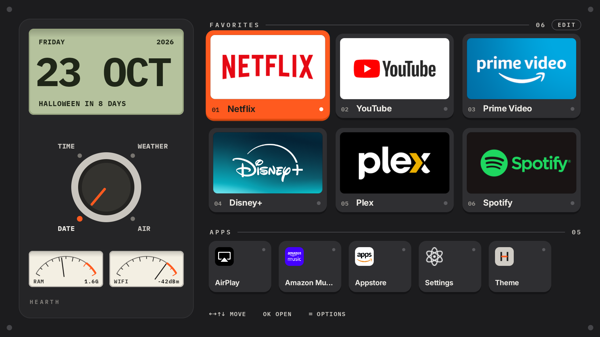
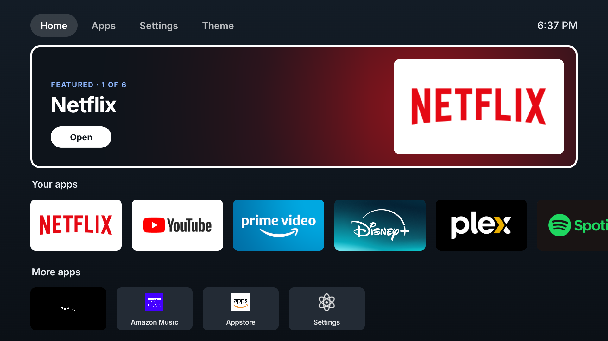

# Hearth

An ad-free home screen for Amazon Fire TV. It replaces Amazon's home screen, with its banner ads and sponsored rows, with one of two layouts you switch between using the remote:

| Console | Default |
|---|---|
|  |  |

- **Console:** a green LCD that shows the time, weather, air quality or date (turn the knob to switch), two needle meters, your six favourite apps as big keys with their real logos, and everything else in a row below. It goes light by day and dark after sunset.
- **Default:** the familiar Fire TV layout (tabs, a big featured banner, rows of apps) with nothing sponsored in it.

There are no ads, no tracking and no accounts. Weather comes from [Open-Meteo](https://open-meteo.com/), and your approximate location comes from your IP address via [GeoJS](https://www.geojs.io/).

## Will it work on my TV?

It has been tested on **one device: a Fire TV smart TV running Fire OS 8.**

| Device | Expected |
|---|---|
| Fire TV smart TVs and Fire TV Sticks on Fire OS 7 or 8 | Should work. Not tested yet. |
| Google TV, Android TV, Nvidia Shield | The app installs and opens, but it **won't take over the Home button**, because that part only watches for Amazon's home screen. |
| Anything that isn't Android TV (Roku, Samsung, LG, Apple TV) | No. |

If you try it on another device, please open an issue saying which model and Fire OS version, and whether it worked.

## Install

You need a computer (Mac, Linux or Windows) on the same Wi-Fi as the TV. You only need it once: after installing, the launcher starts by itself, even after a reboot.

**1. Turn on ADB debugging on the TV**

1. Go to **Settings → My Fire TV** (on some models, **Device & Software**) **→ About**.
2. Select the device name **7 times** until it says you're a developer.
3. Go back, open **Developer options**, and turn on **ADB debugging**.
4. Note the TV's IP address: **Settings → My Fire TV → About → Network**.

**2. Install adb on your computer**

- **Mac:** `brew install --cask android-platform-tools`
- **Windows / Linux:** download [Android SDK Platform-Tools](https://developer.android.com/tools/releases/platform-tools) and add the folder to your PATH.

**3. Install the launcher**

Download `hearth.apk` and `install.sh` from the [Releases](../../releases) page into the same folder, then run:

```bash
./install.sh <TV-IP>          # e.g. the address shown under About → Network
```

The first time, the TV asks **"Allow USB debugging?"**. Tick **Always allow** and choose **OK**. When the script says *Done*, press Home on the remote.

> On Windows, run `install.sh` from Git Bash or WSL.

### Uninstall

```bash
./install.sh <TV-IP> --uninstall
```

The Amazon home screen comes back, and nothing else on the TV is changed.

## Using it

| Remote | What it does |
|---|---|
| Arrows, OK | Move and open apps |
| ≡ (Menu), or hold OK | Move an app, add or remove it from Favorites, hide it, or open its app info |
| **EDIT** (above Favorites) | Pick your six favourite apps |
| ← from the left column | Reach the knob. ← → turns it |
| **Theme** (last key in Apps, or the Theme tab in Default) | Switch between Console and Default |

If you ever land on Amazon's home screen (for example right after installing an update), press **Home** once more.

> ⚠️ **Don't "Force stop" Hearth** in the TV's app settings. Android treats that as switching off the part that catches the Home button, so the TV goes back to Amazon's home screen. Run `install.sh` again to fix it.

## How it takes over the Home button

Fire OS doesn't let you choose a different home app. Instead, the launcher includes a small accessibility service (`HomeGuardService`). When Amazon's home screen appears, it opens Hearth about 0.15 seconds later. You may see Amazon's screen flash briefly, because Fire OS always opens its own home first. The service only learns *which app* comes to the front, so it can stand down when you open something else. It can't read anything on screen and doesn't see your key presses. The installer turns it on with one `adb shell settings put` command, because Fire OS has no on-screen switch for it.

## License

[MIT](LICENSE). The bundled fonts keep their own SIL Open Font License.
